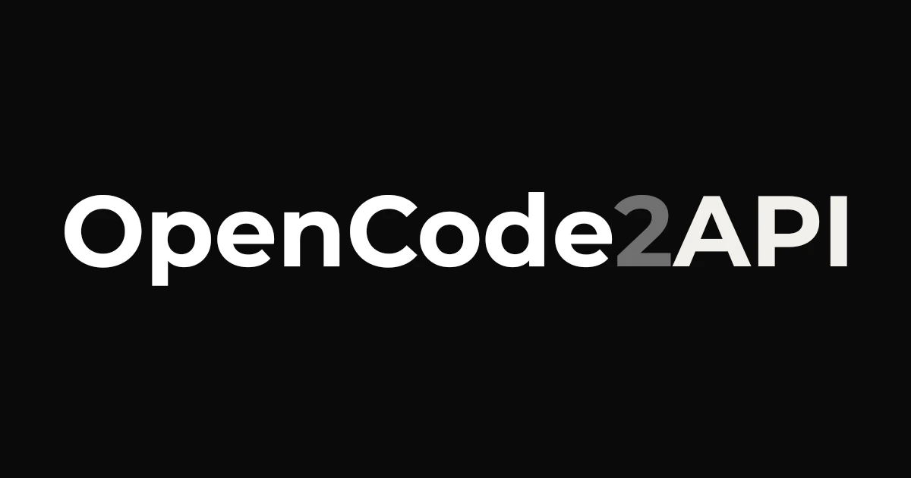

<div align="center">



# OpenCode2API-Proxy

[](https://www.gnu.org/licenses/gpl-3.0)
[](https://www.npmjs.com/package/opencode2api-proxy)
[](https://github.com/IMROVOID/OpenCode2API/actions/workflows/test.yml)
[](https://nodejs.org/)
[](https://www.typescriptlang.org/)
[](https://workers.cloudflare.com/)
[](https://opencode.ai/)
[](https://platform.openai.com/docs/api-reference)

<p align="center">
  OpenCode Zen and Go to a universal OpenAI, Responses and Anthropic compatible API router. Serve <b>Zen</b> and <b>Go</b> models from one endpoint with <b>protocol conversion, streaming, key rotation and a built-in control WebUI</b>.
</p>

[Overview](#what-is-opencode2api-proxy) • [Features](#key-features) • [Quick Start](#quick-start) • [Models](#model-catalog--aliases) • [Clients](#client-integration) • [Architecture](#architecture--structure) • [Guides](#advanced-guides) • [Disclaimer](#disclaimer--legal-notice) • [References](#references--acknowledgements) • [License](#license)

</div>

## Table of Contents

- [What is OpenCode2API-Proxy?](#what-is-opencode2api-proxy)
- [Key Features](#key-features)
- [Quick Start](#quick-start)
  - [Method 1: Local Daemon](#method-1-local-daemon)
  - [Method 2: Built Release](#method-2-built-release)
  - [Method 3: Cloudflare Workers (Serverless)](#method-3-cloudflare-workers-serverless)
  - [Method 4: npm](#method-4-npm)
- [Model Catalog & Aliases](#model-catalog--aliases)
- [Client Integration](#client-integration)
- [Architecture & Structure](#architecture--structure)
- [Advanced Guides](#advanced-guides)
  - [Protocol Conversion](#protocol-conversion)
  - [Key Rotation & Failure Handling](#key-rotation--failure-handling)
  - [Unlimited Lane & Self-Healing Guard](#unlimited-lane--self-healing-guard)
  - [Environment Variables](#environment-variables)
- [Development & Testing](#development--testing)
  - [Continuous Integration (CI)](#continuous-integration-ci)
  - [Building the Release Archives](#building-the-release-archives)
- [Disclaimer & Legal Notice](#disclaimer--legal-notice)
- [References & Acknowledgements](#references--acknowledgements)
- [License](#license)

## What is OpenCode2API-Proxy?

[OpenCode](https://opencode.ai/) serves its **Zen** and **Go** model families behind two different wire shapes. The Zen lane expects the OpenCode 1.x request format, the Go lane the OpenCode 2.x CLI format, and neither is directly consumable by the OpenAI-compatible clients developers actually use.

**OpenCode2API-Proxy** bridges that gap:

1. It discovers the models OpenCode publishes, per tier, and learns each model's **native protocol** from OpenCode's own capability catalog.
2. It serves a single endpoint that speaks **OpenAI Chat Completions**, **OpenAI Responses** and **Anthropic Messages** at the same time, converting a request from the client's protocol to the upstream's and converting the answer back.
3. It rotates across several upstream keys, cools down the ones that fail, and falls back from the anonymous lane to the authenticated tiers.
4. It ships a **control WebUI** with a greyscale dark theme on every deployment method, so the same dashboard works locally, from an archive and on Cloudflare Workers.

> **Note**: The Go lane requires an active OpenCode Go subscription and a workspace in the Global region. The free tier is served from the official OpenCode client only, so it needs that client's TLS fingerprint. See [Disclaimer & Legal Notice](#disclaimer--legal-notice).

> **Reference**: Inspired by and referencing the original [jasonxu114514/opencode2api](https://github.com/jasonxu114514/opencode2api) repository.

## Key Features

- **Three Protocols, One Endpoint**: `/v1/chat/completions`, `/v1/responses` and `/v1/messages` all accept the same request body and answer in the protocol the client asked for.
- **Four Deployment Methods**:
  - **Local Daemon**: Runs on `127.0.0.1:8080` with a control WebUI on `127.0.0.1:8081`.
  - **Built Release**: Cross-platform ZIP archives for Linux, Windows and macOS on x64 and arm64, each with an example configuration.
  - **Cloudflare Worker**: A standalone bundle with no Node built-ins, full control WebUI, and self-healing rotation.
  - **npm**: `npm install -g opencode2api-proxy`.
- **Model Catalog Discovery**: The Zen and Go listings refresh on a timer, and OpenCode's capability catalog teaches the router which protocol each model actually speaks.
- **Protocol-Native Routing**: A request is sent in the upstream's own protocol, so no conversion happens on the hot path unless the client asked for a different one.
- **Key Rotation & Cooldown**: A 401, 403 or 429 rotates to the next key of the tier; the failing key is cooled down with an exponential backoff, and a non-retryable 4xx leaves the tier immediately.
- **Dual-Lane Self-Healing & Quota Bypass**:
  - **OpenCode Unlimited Lane**: Discovers live Cloudflare `AAAA` edge pools via DoH (`1.1.1.1/dns-query`), steers Worker subrequests with `cf.resolveOverride`, rotates device/session/project identities on `QuotaExceeded` / `429` walls (up to 8 hops), and blacklists burned `/64` prefixes.
  - **Kilo Free Gateway Failover**: Seamless secondary fallback to high-throughput free models without quotas.
- **Full SSE Streaming**: Reasoning deltas, tool call arguments and the usage report survive the trip, and a non-streaming client gets the same answer collapsed back into one document.
- **Control WebUI**: A greyscale dark dashboard with the overview, the model routing table, the API keys, the quota, a Playground, the rotation groups, the configuration, the account and a live log stream.
- **Safe & Resource-Bounded**:
  - 32 MB request body limit and 64 MB response body limit.
  - Client disconnect cancellation through `AbortSignal`.
  - An upstream timeout that ends a stalled request instead of hanging it.
  - Secrets masked out of every log line and every WebUI view.

## Quick Start

### Method 1: Local Daemon

#### Step 1: Get an API Key

Create a key in the [OpenCode Console](https://opencode.ai/) and copy it. You need a key for the **Zen** tier, the **Go** tier, or both.

#### Step 2: Install

Install globally via npm:

```bash
npm install -g opencode2api-proxy
```

Or run directly with npx without installation:

```bash
npx opencode2api-proxy start
```

Or when running from a local clone:

```bash
npm install
npm run build
node dist/cli.js start
```

#### Step 3: Configure

Copy the example configuration and edit it:

```bash
cp config.example.json config.json
```

```json
{
  "listen": "127.0.0.1:8080",
  "server_keys": ["sk-your-local-key"],
  "zen_keys": ["sk-your-zen-key"],
  "go_keys": ["sk-your-go-key"],
  "webui": {
    "enabled": true,
    "listen": "127.0.0.1:8081",
    "username": "admin",
    "password": "change-this-admin-password"
  }
}
```

`server_keys` are the keys your clients authenticate with. `zen_keys` and `go_keys` are the keys OpenCode issued you.

#### Step 4: Start the Router

```bash
opencode2api-proxy start
```

Or specify a custom port and key:

```bash
opencode2api-proxy start --port 8080 --key sk-my-secret-key
```

Your local endpoint is available at `http://127.0.0.1:8080/v1`, and the control WebUI at `http://127.0.0.1:8081`.

```bash
curl http://127.0.0.1:8080/v1/chat/completions \
  -H "Authorization: Bearer sk-your-local-key" \
  -H "Content-Type: application/json" \
  -d '{"model":"deepseek-v4.1-flash","messages":[{"role":"user","content":"Hello"}]}'
```

### Method 2: Built Release

Prebuilt archives for every supported platform are attached to each release.

#### Step 1: Download

Grab the archive that matches your platform from the [releases page](https://github.com/IMROVOID/OpenCode2API/releases):

| Target | File |
|---|---|
| Linux x64 | `opencode2api-proxy-v1.0.0-linux-x64.zip` |
| Linux arm64 | `opencode2api-proxy-v1.0.0-linux-arm64.zip` |
| Windows x64 | `opencode2api-proxy-v1.0.0-win-x64.zip` |
| Windows arm64 | `opencode2api-proxy-v1.0.0-win-arm64.zip` |
| macOS (Intel) | `opencode2api-proxy-v1.0.0-macos-x64.zip` |
| macOS (Apple Silicon) | `opencode2api-proxy-v1.0.0-macos-arm64.zip` |

#### Step 2: Extract and configure

```bash
unzip opencode2api-proxy-v1.0.0-linux-x64.zip -d opencode2api-proxy
cd opencode2api-proxy
mv config.example.json config.json
```

Each archive ships a **separate example configuration** named `config.example.json`, so the proxy never overwrites a configuration you already wrote. Rename it to `config.json` and fill in your keys.

#### Step 3: Run

```bash
node opencode2api-proxy.js
```

On Windows:

```powershell
node opencode2api-proxy.js
```

The archive runs on any system with **Node.js 22 or newer**. Install it from [nodejs.org](https://nodejs.org/) if you do not have it.

### Method 3: Cloudflare Workers (Serverless)

Deploy a 24/7 serverless gateway without keeping your computer running.

#### Step 1: Copy the Code

Open [`worker/worker.js`](./worker/worker.js) and copy the entire file contents.

#### Step 2: Create Worker in Cloudflare Dashboard

1. Log into the [Cloudflare Dashboard](https://dash.cloudflare.com).
2. Go to **Workers & Pages** -> **Create application** -> **Create Worker**.
3. Set name to `opencode2api-proxy` and click **Deploy**.
4. Click **Edit code**, select all existing code, delete it, and paste the copied contents of `worker/worker.js`.
5. Click **Deploy** in the top right.

#### Step 3: Add Variables & Secrets

In your Worker, go to **Settings** -> **Variables and Secrets** and configure as needed:

| Variable | Type | Default | Description |
|---|---|---|---|
| `ADMIN_USERNAME` | Text / Secret | `admin` | Username for the control WebUI |
| `ADMIN_PASSWORD` / `WEBUI_PASSWORD` | Secret | `admin` | Password for the control WebUI (change from default in production!) |
| `WEBUI_PATH` / `ADMIN_PATH` | Text | `/` | Web path where the control panel is served (e.g. `/admin`). When customized, `/` returns API health JSON. |
| `WEBUI_ENABLED` | Text | `true` | Set to `false` to completely disable the control WebUI |
| `API_KEY` | Secret | *(None)* | Client bearer authorization key (e.g. `sk-local-key`). Required if clients must authenticate. |
| `OPENCODE_ZEN_KEYS` | Secret | *(None)* | Your OpenCode Zen key(s). Multiple keys separated by commas. |
| `OPENCODE_GO_KEYS` | Secret | *(None)* | Your OpenCode Go key(s). Multiple keys separated by commas. |
| `KILO_API_KEY` | Secret | *(None)* | Kilo Free Gateway key for zero-quota fallback |
| `KILO_API_BASE` | Text | `https://api.kilo.ai/v1` | Kilo API base URL |
| `UPSTREAM_ZEN` | Text | `https://opencode.ai/zen` | Zen upstream base URL |
| `UPSTREAM_GO` | Text | `https://opencode.ai/zen/go` | Go upstream base URL |
| `UPSTREAM_ANONYMOUS` | Text | `https://opencode.ai/inference` | Anonymous free upstream base URL |

Click **Save and deploy**.

#### Worker Control Panel

The built-in control panel provides a live dashboard for monitoring requests, model routing, active pools, quotas, and testing completions in a Playground.

- **Access URL**: By default, navigate to `https://opencode2api-proxy.<your-subdomain>.workers.dev/` (or custom path like `/admin` if `WEBUI_PATH` is set).
- **Default Username**: `admin`
- **Default Password**: `admin`
- **Session Auth**: Stores a secure HTTP-only cookie (`opencode2api_session`).
- **Custom Path Routing**: When `WEBUI_PATH="/admin"` is configured:
  - `GET /` serves `{ "name": "OpenCode2API", "status": "ok", "admin": "/admin" }`
  - `GET /admin` serves the full interactive dashboard
  - All API routes (`/v1/chat/completions`, etc.) continue serving client requests cleanly.

Your Cloudflare Worker API URL:

```
https://opencode2api-proxy.<your-subdomain>.workers.dev/v1
```

### Method 4: npm

```bash
npm install -g opencode2api-proxy
```

```bash
opencode2api-proxy start --config ./config.json
```

The package ships the CLI bundle, the Cloudflare Worker bundle and the example configuration. `npm run build:release` produces the same cross-platform archives the release workflow uploads.

## Model Catalog & Aliases

The router discovers the models OpenCode publishes on each tier and learns each model's native protocol from OpenCode's capability catalog. You always request a **model id**, and the router picks the lane and the protocol.

| Requested model | Lane | Notes |
|---|---|---|
| `deepseek-v4.1-flash` | Zen or Go | Served by the tier that advertises it. |
| `glm-5.3` | Zen or Go | Part of the SOTA rotation group. |
| `grok-4.6` | Zen or Go | Part of the SOTA rotation group. |
| `kimi-k3` | Zen or Go | Part of the SOTA rotation group. |
| `qwen3.8-max` | Zen or Go | Part of the SOTA rotation group. |
| `claude-haiku-5-5` | Zen or Go | Native protocol is Anthropic Messages. |
| `*free` | Anonymous | Served on the anonymous lane when it is enabled. |

The **SOTA rotation group** holds exactly `deepseek-v4.1-flash`, `glm-5.3`, `grok-4.6`, `kimi-k3` and `qwen3.8-max`. The **sweet** group holds the models you add yourself. A rotation alias rotates across the models of its group, so a request for `sota` picks the group member that is currently healthy.

`GET /v1/models` lists everything the router can serve, with each model's native protocol, its context window and its supported endpoints:

```bash
curl http://127.0.0.1:8080/v1/models -H "Authorization: Bearer sk-your-local-key"
```

## Client Integration

<details>
<summary><b>Claude Code</b></summary>

```bash
export ANTHROPIC_BASE_URL="http://127.0.0.1:8080"
export ANTHROPIC_AUTH_TOKEN="sk-your-local-key"
export ANTHROPIC_MODEL="deepseek-v4.1-flash"
claude
```

</details>

<details>
<summary><b>Codex CLI</b></summary>

```toml
# ~/.codex/config.toml
model = "deepseek-v4.1-flash"
model_provider = "opencode2api"

[model_providers.opencode2api]
name = "OpenCode2API"
base_url = "http://127.0.0.1:8080/v1"
env_key = "OPENCODE2API_KEY"
wire_api = "responses"
```

</details>

<details>
<summary><b>OpenCode</b></summary>

```json
{
  "$schema": "https://opencode.ai/config.json",
  "provider": {
    "opencode2api": {
      "npm": "@ai-sdk/openai-compatible",
      "options": {
        "baseURL": "http://127.0.0.1:8080/v1",
        "apiKey": "sk-your-local-key"
      },
      "models": {
        "deepseek-v4.1-flash": { "name": "DeepSeek v4.1 Flash" }
      }
    }
  },
  "model": "opencode2api/deepseek-v4.1-flash"
}
```

</details>

<details>
<summary><b>Cline / Roo Code / Continue</b></summary>

```json
{
  "apiProvider": "openai",
  "openaiApiBase": "http://127.0.0.1:8080/v1",
  "openaiApiKey": "sk-your-local-key",
  "openaiModelId": "deepseek-v4.1-flash"
}
```

</details>

<details>
<summary><b>Cherry Studio / LobeChat / NextChat</b></summary>

Add a custom OpenAI provider:

| Field | Value |
|---|---|
| API address | `http://127.0.0.1:8080/v1` |
| API key | `sk-your-local-key` |
| Model | `deepseek-v4.1-flash` |

</details>

<details>
<summary><b>Any OpenAI-compatible client</b></summary>

Point the client at `http://127.0.0.1:8080/v1` and use `sk-your-local-key` as the API key. Every OpenAI-compatible client works, because the router speaks the client's protocol.

</details>

## Architecture & Structure

```
OpenCode2API-Proxy/
├── src/
│   ├── types/
│   │   ├── config.ts             # Configuration, tier, protocol and log-level contracts
│   │   └── inference.ts          # The protocol-neutral bridge model
│   ├── config/
│   │   ├── defaults.ts           # Default configuration and the SOTA model list
│   │   ├── schema.ts             # The strict configuration schema
│   │   ├── normalize.ts          # The single validation point
│   │   ├── secrets.ts            # Masking, fingerprinting and redaction
│   │   └── store.ts              # Atomic configuration persistence
│   ├── protocol/
│   │   ├── identity.ts           # Session, message and project id derivation
│   │   ├── sha256.ts             # Portable SHA-256 for the Worker bundle
│   │   ├── decode-request.ts     # Client body -> bridge model
│   │   ├── encode-request.ts     # Bridge model -> upstream body
│   │   ├── response.ts           # Upstream body -> client body
│   │   ├── stream-parser.ts      # Upstream SSE -> bridge events
│   │   ├── stream-encoder.ts     # Bridge events -> client SSE
│   │   ├── collapse.ts           # SSE stream -> one response document
│   │   ├── rotation-stream.ts    # Rotation with a commit point
│   │   ├── tools.ts              # The v1 read gate and the v2 core tool gate
│   │   └── lanes.ts              # The v1 and v2 upstream lanes
│   ├── proxy/
│   │   ├── model-catalog.ts      # The discovered models and the routing rules
│   │   ├── model-discovery.ts    # The listings and the capability catalog
│   │   ├── catalog-refresh.ts    # The refresh timer
│   │   ├── attempt-runner.ts     # The key rotation and the cooldown
│   │   ├── request-shaping.ts    # The per-lane request shaping
│   │   └── delivery.ts           # The response relay and the conversion
│   ├── auth/
│   │   └── key-pool.ts           # The key pool with its cooldown
│   ├── unlimited/
│   │   ├── lane.ts               # DoH AAAA edge pool, /64 normalization & identity rotation
│   │   ├── guard.ts              # Quota-wall detector, /64 blacklist & self-healing hop loop
│   │   ├── doctor.ts             # Cloudflare egress verifier & health diagnostics
│   │   └── index.ts              # Public unlimited module exports
│   ├── server/
│   │   ├── dispatcher.ts         # Route matching, CORS and client authentication
│   │   ├── gateway.ts            # The runtime that owns the pools and the catalog
│   │   ├── routes.ts             # Public API routes (/v1/*, /v1/unlimited/*, /healthz)
│   │   ├── completion-handler.ts # The core completion flow
│   │   └── admin/                # The control WebUI and the admin API
│   ├── telemetry/
│   │   ├── metrics.ts            # The request counters, the latency and the usage
│   │   ├── log-broker.ts         # The log ring and the live subscribers
│   │   └── logger.ts             # The structured logger
│   ├── webui/
│   │   ├── document.ts           # The single-file control WebUI
│   │   ├── theme.ts              # The greyscale dark tokens
│   │   └── styles.ts             # The stylesheet
│   ├── cli/
│   │   ├── index.ts              # The CLI entrypoint
│   │   └── commands/start.ts     # The daemon command
│   └── worker/
│       ├── index.ts              # The Cloudflare Workers fetch entrypoint
│       └── unlimited.ts          # Worker self-healing guard, hop & doctor handlers
├── worker/
│   └── worker.js                 # Standalone Cloudflare Worker bundle (95.5 KB)
├── dist/
│   └── cli.js                    # Standalone Node.js CLI executable bundle (309.7 KB)
├── tests/                        # 145 automated unit & integration tests
├── scripts/
│   ├── build.ts                  # The esbuild build pipeline
│   ├── build-release.ts          # The cross-platform archive builder
│   └── zip.ts                    # The dependency-free ZIP writer
├── .github/
│   └── workflows/
│       ├── test.yml              # The CI workflow with skip flags
│       └── release.yml           # The manual multi-OS draft release workflow
├── config.example.json
└── package.json
```

## Advanced Guides

### Protocol Conversion

The router sends a request in the **upstream's own protocol** and only converts when the client asked for a different one.

| Client endpoint | Upstream lane | What happens |
|---|---|---|
| `/v1/chat/completions` | v1 (Zen) | The body is sent as Chat Completions, with a `read` tool guaranteed. |
| `/v1/chat/completions` | v2 (Go) | The body is sent as Chat Completions, with the five core tools guaranteed. |
| `/v1/responses` | any | The body is sent as Responses, and the answer is converted back. |
| `/v1/messages` | any | The body is sent as Anthropic Messages, and the answer is converted back. |

A request to a different protocol than the upstream's is decoded into the bridge model, re-encoded for the upstream, and the answer is converted back on the way out. The same protocol on both sides is passed through untouched, so the common case costs nothing.

**The v1 read gate.** The v1 free tier requires a tool named `read`. A client tool that reads files (`read_file`, `ReadFile`, `read-text-file` and similar) is renamed to `read` on the wire, and the original name is restored in the answer.

**The v2 core tool gate.** The v2 free tier requires the five core tools `shell`, `edit`, `glob`, `grep` and `read`, and compares their description and parameter schema against the official CLI. The genuine definitions ship with the router, so a client that declares its own tools keeps them and the missing core tools are added.

### Key Rotation & Failure Handling

Put several keys in `zen_keys` or `go_keys` and the router distributes the requests across them.

1. **Round-robin**: Each request starts on a different key.
2. **Failure detection**: A 401, 403 or 429 rotates to the next key of the tier.
3. **Cooldown**: The failing key is held back with an exponential backoff, up to eight times the base cooldown. A longer `Retry-After` is honored in full.
4. **Immediate exit**: Any other 4xx is deterministic, so the router leaves the tier at once instead of burning the other keys.
5. **Tier fallback**: When the first tier is exhausted, the next tier in the prefer order takes over.
6. **Anonymous first**: A free model starts on the anonymous lane when `anonymous` is enabled, and falls back to the authenticated tiers when the anonymous lane rejects it.

The rotation groups add one more layer: an alias like `sota` rotates across the models of its group, so a request keeps working when one model is rate-limited.

### Unlimited Lane & Dual-Lane Architecture

OpenCode enforces strict rate limits and device quotas on free-tier inference (`[429]: Free usage limit reached`). OpenCode2API provides a dual-lane architecture to maintain high availability:

```text
Incoming Client Request
       │
       ▼
 ┌──────────────┐
 │ Quota Check  │
 └──────┬───────┘
        │
        ├────────────────────────────────────────────────┐
        ▼ (Lane A)                                       ▼ (Lane B)
 ┌───────────────────────────────┐              ┌─────────────────────────────────┐
 │ OpenCode v2.2.5 Direct Lane   │              │ Kilo Free Gateway Failover      │
 ├───────────────────────────────┤              ├─────────────────────────────────┤
 │ • Live DoH Cloudflare AAAA    │              │ • Zero-quota free tier models   │
 │ • cf.resolveOverride routing  │ ──(Quota ──► │ • Automatic secondary fallback  │
 │ • /64 block blacklist (200)   │    Wall)     │ • KILO_API_KEY / KILO_API_BASE  │
 │ • Clean device ID generation  │              └─────────────────────────────────┘
 │ • Auto-hop (up to 8 attempts) │
 └───────────────────────────────┘
```

1. **OpenCode v2.2.5 Direct Lane (`zen-lane` & `zen-guard`)**:
   - **Live DoH Edge Pool**: Resolves live `AAAA` records for `opencode.ai` via Cloudflare DNS-over-HTTPS (`1.1.1.1/dns-query`), falling back to verified Cloudflare IPv6 edge literals (`2606:4700:10::ac42:ad95`, `2606:4700:10::ac42:ad96`, `2606:4700:10::6814:2011`). On Cloudflare Workers, subrequests are steered directly via `cf.resolveOverride`.
   - **Self-Healing Auto-Hop**: When an upstream request hits a `429`, `403 FreeTierError`, or body containing `QuotaExceeded` / `Free usage limit reached`, the guard normalizes the edge to its `/64` prefix, blacklists it, generates a fresh device identity (`ses_`, `msg_`, 40-hex `project`, 32-hex `machineId`), and retries with a new edge (up to `8` hops transparently).
   - **Oldest-Block Recycling**: Blacklists up to 200 `/64` blocks. If all edges are blacklisted, it recycles the oldest block to prevent starvation.
2. **Kilo Free Gateway Failover**:
   - If direct OpenCode lanes are saturated or repeatedly blocked, configure `KILO_API_KEY` to enable instant fallback to high-throughput free models without quota limits.
3. **Diagnostic & Hop Endpoints**:
   - `GET /v1/unlimited/doctor` — Inspects outbound IPv6 `/64` egress, active edge and session identity, hop count, and blacklist telemetry.
   - `POST /v1/unlimited/hop` — Manually rotates to a fresh `/64` edge and identity immediately.

```bash
# Check unlimited lane & guard health
curl http://127.0.0.1:8080/v1/unlimited/doctor \
  -H "Authorization: Bearer sk-your-local-key"

# Manually hop to a fresh edge and device/session identity
curl -X POST http://127.0.0.1:8080/v1/unlimited/hop \
  -H "Authorization: Bearer sk-your-local-key"
```

### Environment Variables

| Variable | Mode | Default | Description |
|---|---|---|---|
| `OPENCODE2API_CONFIG` | Local | `./config.json` | Path to local configuration file |
| `API_KEY` | Worker | *(None)* | Client authorization bearer token |
| `ADMIN_USERNAME` | Worker | `admin` | Control panel username |
| `ADMIN_PASSWORD` / `WEBUI_PASSWORD` | Worker | `admin` | Control panel password |
| `WEBUI_PATH` / `ADMIN_PATH` | Worker | `/` | Web path where the control panel is served (e.g. `/admin`) |
| `WEBUI_ENABLED` | Worker | `true` | Set to `false` to disable the control WebUI entirely |
| `OPENCODE_ZEN_KEYS` | Worker | *(None)* | Comma-separated OpenCode Zen keys |
| `OPENCODE_GO_KEYS` | Worker | *(None)* | Comma-separated OpenCode Go keys |
| `KILO_API_KEY` | Worker | *(None)* | Kilo Free Gateway API key for quota failover |
| `KILO_API_BASE` | Worker | `https://api.kilo.ai/v1` | Kilo Free Gateway base URL |
| `UPSTREAM_ZEN` | Worker | `https://opencode.ai/zen` | Zen upstream base URL |
| `UPSTREAM_GO` | Worker | `https://opencode.ai/zen/go` | Go upstream base URL |
| `UPSTREAM_ANONYMOUS` | Worker | `https://opencode.ai/inference` | Anonymous free upstream base URL |

## Development & Testing

<!-- AUTO-GENERATED:SCRIPTS -->
| Command | Description |
|---|---|
| `npm run typecheck` | Run TypeScript compiler type checking (`tsc --noEmit`) |
| `npm test` | Run automated unit and integration test suite (`tsx --test tests/**/*.test.ts`) |
| `npm run build` | Bundle standalone CLI (`dist/cli.js`) and Cloudflare Worker (`worker/worker.js`) |
| `npm run verify:worker` | Verify `worker/worker.js` in a Cloudflare Workers global-scope sandbox and run handler smoke tests |
| `npm run build:release` | Build cross-platform release ZIP archives into `release/` |
| `npm run prepublishOnly` | Run typecheck, tests, bundle build, and Worker verification before publishing |
| `npm start` | Start the local proxy daemon directly from TypeScript source |
<!-- /AUTO-GENERATED:SCRIPTS -->

Run typecheck:

```bash
npm run typecheck
```

Run the automated test suite:

```bash
npm test
```

Build the standalone bundles:

```bash
npm run build
```

### Continuous Integration (CI)

Every commit and pull request runs automated verification through the [Test & Verify](.github/workflows/test.yml) GitHub Actions workflow (Node.js 22):

- **Typecheck**: `npm run typecheck`
- **Unit & Integration Tests**: `npm test`
- **Bundle Verification**: `npm run build`, plus a check that the Worker bundle carries no Node built-in.

#### Skipping Automated Tests

To skip the test suite on specific commits (e.g. for docs updates, asset additions, or fast iterations while still verifying types and builds), include any of the following tags in the commit message:

- `[skip test]` or `[skip tests]`
- `[skip-test]` or `[skip-tests]`

When triggered manually via **Actions** -> **Run workflow**, check the **Skip running automated tests** input option.

### Building & Publishing Releases

The [Release workflow](.github/workflows/release.yml) builds multi-arch platform binaries and the standalone Cloudflare Worker bundle, publishing them as a **Draft Release** on GitHub.

#### Trigger Options

1. **Manual Trigger (`workflow_dispatch`)**:
   - Go to **Actions** -> **Release** -> **Run workflow**.
   - **Tag**: Release tag (defaults to `v` + `version` from `package.json`, e.g. `v1.0.0`).
   - **Draft**: Create as Draft release (defaults to `true`). Uncheck when ready to publish publicly.
   - **Overwrite**: If a release or tag with this name already exists, delete and recreate it (defaults to `true`).
   - **Custom Release Notes**: Optional markdown text to use as release notes. Leave empty to use GitHub's auto-generated release notes.
   - **Skip tests**: Check to bypass test execution during release packaging.
2. **Automatic Trigger via Commit Flag**:
   - Push a commit to `master` containing `[release]`, `[draft-release]`, or `[release-draft]` in the commit message.
   - Automatically builds and publishes a Draft release for the current `package.json` version.

#### Release Assets

Each release attaches:
- 6 platform ZIP archives: `linux-x64`, `linux-arm64`, `win-x64`, `win-arm64`, `macos-x64`, `macos-arm64`.
- Standalone Cloudflare Worker script: `worker.js` (evaluated and pre-tested).

To build the release archives locally:

```bash
npm run build
npm run build:release
```

The archives land in `release/`.

## Disclaimer & Legal Notice

> **IMPORTANT**: Please read this notice carefully before using or deploying OpenCode2API-Proxy.

1. **Educational & Research Purposes Only**: This project is developed and distributed exclusively for personal educational, research, and non-commercial API interoperability testing purposes.
2. **Upstream Terms of Service**: Routing requests to OpenCode's Zen, Go or free tier through a third-party client may violate OpenCode's Terms of Service. The free tier explicitly restricts access to the official OpenCode client, and the Go tier requires a paid subscription. OpenCode may rate-limit, revoke keys, or suspend accounts that use the upstream outside its own client.
3. **No Warranty & No Guarantee**: The author and contributors make no claims, promises, or guarantees regarding the safety, status, or longevity of your OpenCode account or subscription. This software is provided "AS IS", without warranty of any kind, express or implied.
4. **Assumption of Risk**: You assume full and sole responsibility for any outcomes or damages resulting from using this software, including but not limited to account termination, loss of API access, or data loss. Use strictly at your own risk.
5. **Trademark Attribution**: All product names, logos, and brands (such as "OpenCode", "OpenAI", "Anthropic") are trademarks or registered trademarks of their respective owners. OpenCode2API-Proxy is an independent open-source project and is neither affiliated with, maintained by, nor endorsed by any of them.

## References & Acknowledgements

- [jasonxu114514/opencode2api](https://github.com/jasonxu114514/opencode2api) — Original reference repository for OpenCode API proxying and reverse engineering.
- [ElectronBreach/opencode-unlimited-usage](https://github.com/ElectronBreach/opencode-unlimited-usage) — Reference implementation for `AAAA` edge pool rotation, `/64` prefix blacklisting, and self-healing quota-wall recovery.

## License

This project is licensed under the **GNU General Public License v3.0 (GPLv3)**. See the [LICENSE](./LICENSE) file for details.
